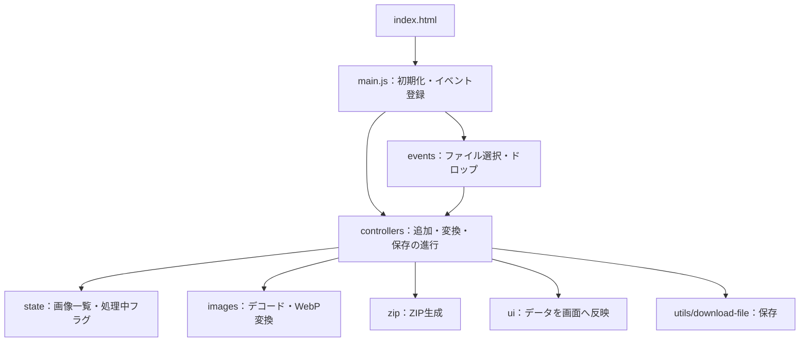

# 画像をWebPに変換

JPEG・PNGなどを、ブラウザ内でWebPへ一括変換する静的サイトです。HTML・CSS・JavaScriptのみで動作し、画像のアップロード先となるサーバーや外部APIは使いません。

[GitHubのソースコード](https://github.com/Syo-M/WebPImageConverter) · [サイトを開く](https://syo-m.github.io/WebPImageConverter/) · [リリース](https://github.com/Syo-M/WebPImageConverter/releases)

## ローカルで動かす

1. GitHubの **Code → Download ZIP** からファイルをダウンロードし、ZIPを展開します。
2. VS Codeの **ファイル → フォルダーを開く** で、展開したプロジェクトのフォルダーを開きます。
3. VS Codeの拡張機能で **Live Server**（公開者：Ritwick Dey）を検索し、インストールします。拡張機能は[こちら](https://marketplace.visualstudio.com/items?itemName=ritwickdey.LiveServer)からも確認できます。
4. VS Codeのファイル一覧で `index.html` を右クリックし、**Open with Live Server** を選びます。
5. 自動で開いたブラウザで画像を追加し、変換を実行できます。

モジュールを読み込むため、`index.html`はLive Server経由で開きます。ファイルを編集・保存すると、ブラウザの表示も更新されます。

## できること

- JPEG / PNG / GIF / WebP / BMP / AVIFの混在した複数画像を追加
- ファイル選択・ドラッグ＆ドロップ、追加直後のサムネイル表示
- 10〜100%の画質指定、縦横比を保つ縮小、透明背景の保持・白背景への合成
- 変換前後の容量・削減率・出力サイズの確認
- 個別ダウンロード、成功した画像をまとめたZIP保存
- 同名ファイルの連番化、個別・一括削除、設定変更後の再変換
- 壊れた画像などが混ざった場合のエラー表示と、残りの画像の変換継続

## コードを読む順番

まずは [js/main.js](js/main.js) を開いてください。イベントと呼び出す関数の対応が、アプリ全体の入口です。関数名を探すと、その処理を担当するファイルへ進めます。

| 順番 | 読むファイル | 注目すること |
| --- | --- | --- |
| 1 | [main.js](js/main.js) | `import`、初期化、`addEventListener`による操作と処理の接続 |
| 2 | [elements.js](js/ui/elements.js)、[state.js](js/state.js) | HTML要素とアプリの管理データを分ける考え方 |
| 3 | [file-input-events.js](js/events/file-input-events.js)、[file-controller.js](js/controllers/file-controller.js) | 選択・ドロップから画像を追加する流れ |
| 4 | [file-validation.js](js/file-validation.js)、[file-names.js](js/utils/file-names.js) | 形式・容量のチェック、重複しない保存名の作り方 |
| 5 | [conversion-controller.js](js/controllers/conversion-controller.js) | `async` / `await`、1枚ずつの処理、例外処理 |
| 6 | [decode-image.js](js/images/decode-image.js)、[convert-image.js](js/images/convert-image.js) | 画像の読み込み、Canvasへの描画、`toBlob()`によるWebP生成 |
| 7 | [file-list.js](js/ui/file-list.js)、[page.js](js/ui/page.js) | 管理データをDOMへ反映し、画面を更新する方法 |
| 8 | [download-controller.js](js/controllers/download-controller.js)、[download-file.js](js/utils/download-file.js) | 個別保存とZIP保存の進行 |
| 9 | [create-zip.js](js/zip/create-zip.js)と同じフォルダの2ファイル | バイナリデータの結合、ZIPの構造、CRC-32 |

短い関数から読みたい場合は、[quality.js](js/quality.js)や[format-file-size.js](js/utils/format-file-size.js)から始めることもできます。この2つはDOMを使わず、入力から結果を返す関数です。

## ファイル構成

```text
.
├── index.html                    # 画面・画像一覧のtemplate・moduleの入口
├── styles.css                    # 変換画面のスタイル
├── js/
│   ├── main.js                   # 起動とイベントの接続
│   ├── config.js                 # 枚数・容量・画素数の上限
│   ├── state.js                  # 一覧データと一時URLの管理
│   ├── file-validation.js        # 追加するファイルの検証
│   ├── quality.js                # 低・中・高画質の説明
│   ├── events/
│   │   └── file-input-events.js  # 選択・ドラッグ＆ドロップ
│   ├── controllers/              # 複数の機能を順番につないで処理を進める
│   │   ├── file-controller.js    # 画像の追加・削除・設定変更
│   │   ├── conversion-controller.js # 一括変換の進行
│   │   └── download-controller.js   # 個別・ZIP保存の進行
│   ├── images/
│   │   ├── decode-image.js       # File / Blobを描画できる画像にする
│   │   └── convert-image.js      # 縮小・背景合成・WebP生成
│   ├── ui/
│   │   ├── elements.js           # HTML要素とJSの名前の対応表
│   │   ├── file-list.js          # サムネイル・ファイル情報の行
│   │   └── page.js               # ボタン・集計・通知・進捗・画質説明
│   ├── utils/
│   │   ├── file-names.js         # 出力ファイル名の作成
│   │   ├── format-file-size.js   # B / KB / MB表示
│   │   └── download-file.js      # Blobのダウンロード
│   └── zip/
│       ├── create-zip.js         # ZIP全体の組み立て
│       ├── zip-headers.js        # ZIP仕様に従うヘッダーの生成
│       └── crc32.js              # データ破損を検出する検査値
├── assets/                       # ロゴ・ファビコン・OGP画像
├── privacy.html                  # 日英のプライバシーポリシー
├── terms.html                    # 日英の利用条件
├── licenses.html                 # 日英の権利・ライセンス表示
├── legal.css                     # ポリシーページのスタイル
├── LICENSE                       # ソースコード等の権利表示
├── package.json                  # Node.jsでのES Modules指定（依存なし）
└── .nojekyll                     # 静的ファイルの配信設定
```

## モジュール同士の関係

`main.js`は操作の接続、`controllers/`は処理の順序、`ui/`は表示を担当します。画像処理やZIP処理は、画面のボタンやファイル一覧を直接書き換えません。



これは主な呼び出し・更新の関係です。例えば`config.js`や容量表示用の関数など、共通の補助モジュールは省略しています。

### ES Modulesの基本

HTMLは入口のファイルだけを読み込みます。

```html
<script type="module" src="js/main.js"></script>
```

関数を別ファイルへ公開するときは`export`、利用するときは`import`を使います。

```js
// quality.js：他のファイルから使える関数として公開する
export function getQualityDescription(qualityPercent) {
  // 実際の実装は js/quality.js を参照
}

// ui/page.js：必要な名前を指定して読み込む
import { getQualityDescription } from '../quality.js';
```

ブラウザが`import`をたどって必要なファイルを読み込みます。相対パスと`.js`の拡張子を指定することで、GitHub Pagesのリポジトリ配下でも動きます。モジュールは自動的にstrict modeで動き、同じモジュールは1回だけ評価されます。

## 画像1枚のデータを追う

[state.js](js/state.js)の`createImageEntry()`が、元ファイルと作業用データをまとめたオブジェクトを作ります。

| プロパティ | 内容 |
| --- | --- |
| `originalFile` | 利用者が選択した元の`File`。変換で書き換えません |
| `outputFileName` | 重複を避けたWebP保存名。例：`photo (2).webp` |
| `originalPreviewUrl` | 追加直後から元画像を表示するための一時URL |
| `convertedBlob` | 変換成功時に入るWebPのバイナリデータ。変換前は`null` |
| `convertedPreviewUrl` | 変換結果を表示するための一時URL |
| `outputWidth` / `outputHeight` | 変換結果の横幅・高さ |
| `isConverting` / `errorMessage` | その画像の処理状態とエラー |
| `previewFailed` | 元画像のプレビュー読み込みに失敗したか |
| `rowElement` | その画像に対応する一覧の`li`要素 |

`appState.imageEntries`は、このオブジェクトの配列です。`appState.isConverting`と`appState.isCreatingZip`は、アプリ全体が処理中かを表します。**画像ごとの状態と、一覧全体の状態は別です。**

### 追加から変換まで

1. `handleFileSelection()`または`handleFileDrop()`が`FileList`を受け取ります。
2. `addImageFiles()`が検証し、`createImageEntry()`で管理データを作ります。
3. `addImageRow()`がHTMLの`template`をコピーし、元画像のサムネイルを表示します。
4. 変換ボタンで`convertPendingImages()`を呼び、未変換の画像だけを別配列へ取り出します。
5. `convertImageToWebp()`がデコード・縮小・背景描画・WebP書き出しを行います。
6. コントローラーが返されたBlobとサイズを管理データへ格納します。
7. `renderImageRow()`と`renderPage()`が、変換状態・サムネイル・容量・ボタンを更新します。

変換を開始した後に追加された画像は、次回の対象になります。1枚失敗しても`catch`でその画像のエラーを記録し、残りを処理します。

### 設定を変えるとき・画像を削除するとき

設定変更時は`resetConversionResult()`が**変換結果だけ**を破棄します。`originalPreviewUrl`を残すので、サムネイルが消えません。画像を一覧から削除するときは`disposeImageEntry()`が元画像用のURLも解放します。

`URL.createObjectURL()`で作った一時URLは、不要になったら`URL.revokeObjectURL()`で解放します。URLを解放することと、端末の元ファイルを削除することは別です。

### ZIPを保存するとき

`downloadCompletedImagesAsZip()`は成功した画像を選び、`{ name, blob }`の配列に変換して`createZipArchive()`へ渡します。ZIPモジュールは画像一覧のDOMや管理データを知る必要がありません。

ZIPは次の順に部品を並べます。

```text
[ローカルヘッダー + UTF-8ファイル名 + WebPデータ] × 枚数
[中央ディレクトリ（ファイルの位置を記録する目次）]
[目次終端ヘッダー]
```

WebPはすでに圧縮されているため、ZIPではSTORE（再圧縮しない）方式を使います。CRC-32はデータの破損を検出する検査値です。暗号化や安全性の保証ではありません。ヘッダー内の数字の位置はZIP形式の仕様に従い、[zip-headers.js](js/zip/zip-headers.js)にコメントを付けています。

## このコードで使う主な用語

| 用語 | このアプリでの使い方 |
| --- | --- |
| DOM | ボタン・画像一覧など、HTMLをJavaScriptから操作するための要素 |
| `File` | 選択したファイル。名前・サイズ・MIMEタイプなどを持つ |
| `Blob` | WebPやZIPの本体となるバイナリデータ |
| Object URL | BlobやFileを画像・ダウンロードリンクから参照する一時URL |
| Canvas | 縮小した画像を描画し、WebPとして書き出す作業領域 |
| `Promise` / `await` | 画像の読み込みや書き出しの完了を待つ仕組み |
| `try` / `catch` / `finally` | 失敗の扱いと、成功・失敗にかかわらず必要な後片付け |
| `Uint8Array` / `DataView` | ZIPのようなバイト列を読み書きするための道具 |

## 画質・仕様・上限

画質の表示区分は10〜39%が低画質、40〜79%が中画質、80〜100%が高画質です。数値はエンコーダーへ渡す品質指定で、保持される画質の割合ではありません。100%でも可逆圧縮は指定しません。

- 元画像のメタデータ（EXIFなど）は引き継ぎません。色・輪郭・質感が変わる場合があります。
- アニメーションは静止画になります。通常は先頭フレーム、一部のブラウザでは表示時点のフレームになります。
- HEIC・HEIFは非対応です。入力形式の読み込み・WebP書き出しの可否はブラウザに依存します。
- 入力は1枚50MB・一覧100枚・合計500MB・元画像4,000万画素まで、ZIP内の出力合計は500MBまでです。端末のメモリにより、それ以下でも失敗する場合があります。
- 容量が必ず小さくなるわけではありません。元画像を保管し、結果を確認してください。
- ページを閉じると作業結果が失われる場合があります。ZIP64には対応しません。

上限は[config.js](js/config.js)、画質の説明は[quality.js](js/quality.js)で確認できます。

## ポリシー・権利表示

[プライバシーポリシー](privacy.html) · [利用条件](terms.html) · [ライセンス表示](licenses.html) · [LICENSE](LICENSE) · [権利関係の確認記録](RIGHTS_REVIEW.md)

運営者はsyo motoyama、公開連絡先はsyoeureka@gmail.comです。GitHub PagesのIP記録と、メール問い合わせの取り扱いはプライバシーポリシーに記載しています。

コードの閲覧と、個人学習のためのダウンロード・ローカル実行・ローカル改変を許可しています。再配布・別サイトでの公開等は本許諾に含まれません。法令・GitHubの規約等による権利は制限しません。MIT等のOSSライセンスではなく、詳しくは[LICENSE](LICENSE)を確認してください。画像変換サービスは個人・業務とも無料で利用できます。

ロゴ・OGPはImagegenで生成し、ファビコンは生成ロゴから書き出しています。第三者のJavaScript・WebAssembly・フォントは同梱していません。広告・解析・画像送信などの機能を追加する場合は、実際の取り扱いに合わせてポリシーも更新してください。

## 参考資料

- [MDN：JavaScript Modules](https://developer.mozilla.org/en-US/docs/Web/JavaScript/Guide/Modules)
- [MDN：CanvasのtoBlob()](https://developer.mozilla.org/en-US/docs/Web/API/HTMLCanvasElement/toBlob)
- [GitHub Pages：データの収集](https://docs.github.com/en/pages/getting-started-with-github-pages/what-is-github-pages#data-collection)
