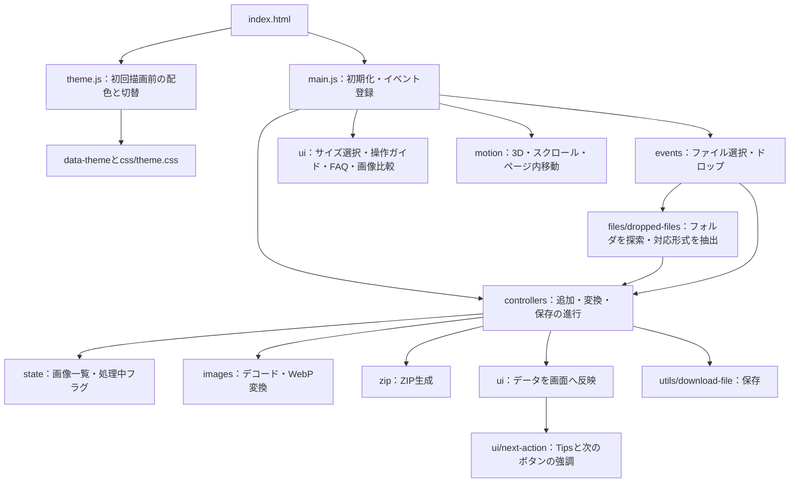
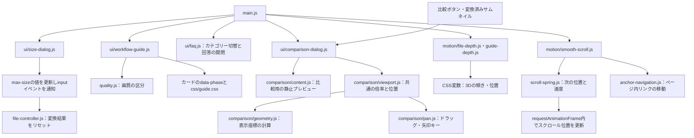
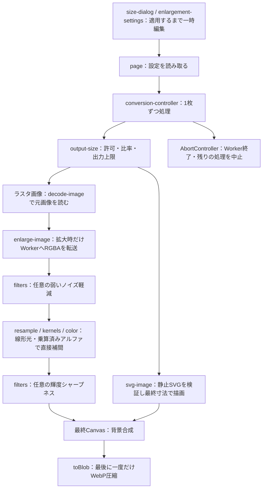

# 画像をWebPに変換

JPEG・PNGなどを、ブラウザ内でWebPへ一括変換する静的サイトです。HTML・CSS・JavaScriptのみで動作し、画像のアップロード先となるサーバーや外部APIは使いません。

[GitHubのソースコード](https://github.com/Syo-M/WebPImageConverter) · [サイトを開く](https://syo-m.github.io/WebPImageConverter/) · [リリース](https://github.com/Syo-M/WebPImageConverter/releases)

## 最新版：v1.5.0

画像の拡大と静止SVG入力に対応しました。補間・補正の設定と説明を追加し、FAQと解説コンテンツも更新しています。

出力サイズの「元画像より大きくすることを許可」をONにすると、拡大設定を表示します。初期値はOFFです。ONにして長辺を指定すれば「おまかせ」で処理できます。「元のサイズ」はONでも原寸を維持します。

拡大を許可して長辺を指定すると、Tips内とWebP出力欄のボタンはどちらも「拡大してWebPに変換」と表示します。拡大OFF・元のサイズでは「WebPに変換」に戻り、Tipsの案内もボタンの表記に合わせます。

- おまかせは穏やかなバイキュービック補間。シャープネス・ノイズ軽減はOFF
- カスタマイズでは写真（Lanczos 3）、イラスト（バイキュービック）、ロゴ・図形（バイリニア）、ピクセルアート（最近傍）を選択。補間方式の手動指定にも対応
- シャープネスとノイズ軽減は任意。最近傍では補正せず、ドットを維持
- 補正スライダーはOFF／弱め（5〜30%）／中程度（35〜65%）／強め（70〜100%）で説明を切り替え、効果と細部への影響を案内。数値は補正強度の目安で、改善率ではありません
- シャープネス・ノイズ軽減は独立したカードにまとめ、項目名・数値・目的・現在の効果を文字サイズと背景で区別。共通の補足は「調整の目安」として分けて表示
- カスタマイズ時は画像一覧の種類指定で、混在した画像に個別の種類を適用可能
- 元画像から目的サイズへ直接補間し、最後に一度だけ通常のWebPへ圧縮
- 静止SVGは指定サイズで直接描画。外部参照・アニメーション・foreignObject・DOCTYPEは非対応。文字の再現性にはアウトライン化を推奨
- 処理はブラウザ内で完結し、拡大計算はWeb Workerで実行。中止ボタンで実行中のWorkerと残りの処理を止め、完了済み画像は保存可能
- 一覧・比較に元寸法、出力寸法、倍率、適用した補間を表示
- FAQはカテゴリー別に表示し、初期表示は「形式・画質」。FAQ下の「詳細を見る」で4種類の補間と2種類の補正の解説を展開

拡大は細部の復元を保証しません。出力はsRGBを基準とし、HDRや広色域の完全保持は対象外です。画質100%でもロスレスではありません。PNG出力・ロスレスWebP・外部エンコーダーは追加していません。

詳細は[v1.5.0のRelease](https://github.com/Syo-M/WebPImageConverter/releases/tag/v1.5.0)で確認できます。

### v1.4.1での主な変更

CSSファイル5点をルートから`css/`フォルダへ移動し、ファイル構成を整理しました。変換画面・ポリシーページの読み込みパスと、READMEの構成図・リンクを更新しています。CSSの内容、画面デザイン、機能に変更はありません。

詳細は[v1.4.1のRelease](https://github.com/Syo-M/WebPImageConverter/releases/tag/v1.4.1)で確認できます。

### v1.4.0での主な変更

フォルダからの一括取り込みと、追加・変換・保存の操作案内を追加しました。

- フォルダをドラッグ＆ドロップすると、サブフォルダ内も含めて対応形式の画像だけを抽出します
- 非対応ファイルや読み取り失敗はスキップし、件数を通知します。既存の容量・枚数制限も適用します
- Tipsを「次は画像を変換」「次はZIPで保存」へ切り替え、Tips内からも変換・ZIP保存を実行できます
- 次に操作するボタンをアクセント色と立体感で強調し、段階が切り替わる瞬間だけ発光します
- ボタンの拡大縮小と表面のグラデーションは、どちらも0.7秒で一度だけ再生します
- ホバーで浮き、押すと沈む動きを追加。「視差効果を減らす」設定にも対応します

フォルダの読み取りとTipsの状態管理は専用モジュールへ分け、構成図・日本語コメント・処理の説明を更新しています。画像処理は引き続きブラウザ内で完結します。

詳細は[v1.4.0のRelease](https://github.com/Syo-M/WebPImageConverter/releases/tag/v1.4.0)で確認できます。

### v1.3.0での主な変更

変換したWebPを保存する前に、元画像との画質の違いを拡大して確認できるようになりました。

- 各画像の「変換前後を比較」ボタン、またはサムネイルから比較画面を開けます
- 全体表示・100%表示・最大400%の拡大に対応し、左右の表示倍率と移動位置を連動します
- ドラッグ・矢印キーで同じ箇所を確認でき、スマートフォンでは上下に並べて表示します
- 比較画面からWebPを個別保存できます
- 一覧のサムネイルを拡大し、ファイル名の上端から比較ボタンの下端まで揃えました

比較処理もブラウザ内で完結します。比較用の元画像はWebPと同じ出力サイズへ揃えて表示します。追加した処理は表示・読み込み・座標計算・移動操作に分け、日本語コメントと下記の構成図で説明しています。

詳細は[v1.3.0のRelease](https://github.com/Syo-M/WebPImageConverter/releases/tag/v1.3.0)で確認できます。

### v1.2.0での主な変更

ライト／ダークの表示切り替えに対応しました。ヘッダーの月／太陽ボタンで変更できます。

- 保存した選択がなければ、端末・ブラウザの配色設定に自動で合わせます
- ユーザーが切り替えると、その選択をブラウザに保存し、次回から優先して表示します
- 変換画面・操作ガイド・FAQ・ガラス調モーダル・ポリシーページも同じ配色で表示します
- 保存するのは配色の選択だけです。画像や変換結果は永続保存しません

保存内容は日英のプライバシーポリシーにも記載しています。画像変換・保存の仕様に変更はありません。

詳細は[v1.2.0のRelease](https://github.com/Syo-M/WebPImageConverter/releases/tag/v1.2.0)で確認できます。

### v1.1.1での主な変更

出力サイズモーダルを半透明のガラス調に変更しました。背後の色や形を柔らかくぼかし、縁の光沢と影で奥行きを付けています。選択カード・閉じるボタン・カスタム入力欄も同じ質感に統一しました。

選択状態と文字の読みやすさを保ち、背景ぼかしの非対応ブラウザ、透明度を下げる設定、強制カラーモードでは不透明な背景などに切り替えます。画像変換・保存の仕様に変更はありません。

詳細は[v1.1.1のRelease](https://github.com/Syo-M/WebPImageConverter/releases/tag/v1.1.1)で確認できます。

### v1.1.0での主な変更

Bentoレイアウトへ画面を刷新しました。画像の追加・変換設定・プレビュー一覧・保存を4つの区画にまとめ、サイト名をコンパクトなヘッダーに統合しています。

- 出力サイズを用途別のカードから選ぶモーダルを追加。カスタム値の指定にも対応
- 3Dのファイル表現と、初回ホバー・ボタンで再生できる操作手順を追加
- FAQをカテゴリーで絞り込めるカード型に変更し、回答を滑らかに開閉
- 入力した距離を保つ慣性スクロールと、ページ内リンクの滑らかな移動を追加
- モバイル表示・キーボード操作・OSの「視差効果を減らす」設定に対応

画像の変換・個別ダウンロード・ZIP保存は引き続きブラウザ内で行います。外部JavaScriptライブラリは追加していません。

変更点の詳細は[v1.1.0のRelease](https://github.com/Syo-M/WebPImageConverter/releases/tag/v1.1.0)で確認できます。

## ローカルで動かす

1. GitHubの **Code → Download ZIP** からファイルをダウンロードし、ZIPを展開します。
2. VS Codeの **ファイル → フォルダーを開く** で、展開したプロジェクトのフォルダーを開きます。
3. VS Codeの拡張機能で **Live Server**（公開者：Ritwick Dey）を検索し、インストールします。拡張機能は[こちら](https://marketplace.visualstudio.com/items?itemName=ritwickdey.LiveServer)からも確認できます。
4. VS Codeのファイル一覧で `index.html` を右クリックし、**Open with Live Server** を選びます。
5. 自動で開いたブラウザで画像を追加し、変換を実行できます。

モジュールを読み込むため、`index.html`はLive Server経由で開きます。ファイルを編集・保存すると、ブラウザの表示も更新されます。

## できること

- JPEG / PNG / GIF / WebP / BMP / AVIF / SVGの混在した複数画像を追加
- ファイル選択・ドラッグ＆ドロップ、追加直後のサムネイル表示
- フォルダ・サブフォルダ内の対応画像をまとめて抽出（フォルダのドロップに対応したブラウザ）
- 追加後は変換へTipsで案内し、変換後はZIP保存ボタンをアクセント色で表示
- 10〜100%の画質指定、縦横比を保つ縮小・任意の拡大、透明背景の保持・白背景への合成
- モーダルで出力サイズを選択（元のサイズ・プリセット・カスタム指定）
- ライト／ダークの切り替え、端末設定への初回追従、表示テーマの保存
- 変換前後の容量・削減率・出力サイズの確認
- 各画像の「変換前後を比較」ボタンから元画像とWebPを拡大比較（左右の倍率・位置を連動）
- 個別ダウンロード、成功した画像をまとめたZIP保存
- 同名ファイルの連番化、個別・一括削除、設定変更後の再変換
- 壊れた画像などが混ざった場合のエラー表示と、残りの画像の変換継続

## コードを読む順番

まずは [js/main.js](js/main.js) を開いてください。イベントと呼び出す関数の対応が、アプリ全体の入口です。関数名を探すと、その処理を担当するファイルへ進めます。

| 順番 | 読むファイル | 注目すること |
| --- | --- | --- |
| 1 | [main.js](js/main.js) | `import`、初期化、`addEventListener`による操作と処理の接続 |
| 2 | [elements.js](js/ui/elements.js)、[state.js](js/state.js) | HTML要素とアプリの管理データを分ける考え方 |
| 3 | [file-input-events.js](js/events/file-input-events.js)、[file-controller.js](js/controllers/file-controller.js) | 選択・ドロップから画像を追加する流れ |
| 4 | [file-validation.js](js/file-validation.js)、[file-names.js](js/utils/file-names.js) | 形式・容量のチェック、重複しない保存名の作り方 |
| 5 | [conversion-controller.js](js/controllers/conversion-controller.js) | `async` / `await`、1枚ずつの処理、例外処理 |
| 6 | [decode-image.js](js/images/decode-image.js)、[convert-image.js](js/images/convert-image.js) | 画像の読み込み、Canvasへの描画、`toBlob()`によるWebP生成 |
| 7 | [file-list.js](js/ui/file-list.js)、[page.js](js/ui/page.js)、[conversion-summary.js](js/ui/conversion-summary.js) | 管理データをDOMへ反映し、画面を更新する方法 |
| 8 | [download-controller.js](js/controllers/download-controller.js)、[download-file.js](js/utils/download-file.js) | 個別保存とZIP保存の進行 |
| 9 | [create-zip.js](js/zip/create-zip.js)と同じフォルダの2ファイル | バイナリデータの結合、ZIPの構造、CRC-32 |
| 10 | [size-dialog.js](js/ui/size-dialog.js)、[workflow-guide.js](js/ui/workflow-guide.js)、[faq.js](js/ui/faq.js) | モーダルの一時状態、操作例の再生、絞り込み、アニメーションの中断 |
| 11 | [smooth-scroll.js](js/motion/smooth-scroll.js)、[scroll-spring.js](js/motion/scroll-spring.js)、[anchor-navigation.js](js/motion/anchor-navigation.js) | 入力と描画を分けること、位置・速度・経過時間、ページ内移動 |
| 12 | [file-depth.js](js/motion/file-depth.js)、[guide-depth.js](js/motion/guide-depth.js) | CSS変数、ポインター追従、IntersectionObserver |
| 13 | [theme.js](js/theme.js) | 初回描画前の配色、端末設定、localStorage、ページ間の共有 |
| 14 | [comparison-dialog.js](js/ui/comparison-dialog.js)と[js/comparison/](js/comparison/) | 非同期読み込みの中断、同じ座標・倍率での比較、ドラッグとキーボード操作 |

短い関数から読みたい場合は、[quality.js](js/quality.js)や[format-file-size.js](js/utils/format-file-size.js)から始めることもできます。この2つはDOMを使わず、入力から結果を返す関数です。

## ファイル構成

```text
.
├── index.html                    # 画面・画像一覧のtemplate・moduleの入口
├── css/                          # スタイルシート
│   ├── styles.css                # 変換画面のスタイル
│   ├── guide.css                 # 操作手順・FAQのレイアウトとアニメーション
│   ├── theme.css                 # 配色・切替ボタン・ダークモードの各画面
│   ├── comparison.css            # 比較画面・拡大表示・一覧の高さ揃え
│   ├── enlargement.css           # 拡大トグル・補間設定・中止ボタン
│   ├── enlargement-guide.css     # FAQ下の補間・補正の解説カード
│   └── legal.css                 # ポリシーページのスタイル
├── js/
│   ├── main.js                   # 起動とイベントの接続
│   ├── theme.js                  # 初回描画前の配色・テーマ切替と保存
│   ├── config.js                 # 枚数・容量・画素数の上限
│   ├── state.js                  # 一覧データと一時URLの管理
│   ├── file-validation.js        # 追加するファイルの検証
│   ├── quality.js                # 低・中・高画質の説明
│   ├── enlargement-effects.js    # 補正の強さの区分・効果と細部への影響の説明
│   ├── files/
│   │   └── dropped-files.js      # ドロップ内容の確保・フォルダ内の対応画像探索
│   ├── events/
│   │   └── file-input-events.js  # 選択・ドラッグ＆ドロップ
│   ├── controllers/              # 複数の機能を順番につないで処理を進める
│   │   ├── file-controller.js    # 画像の追加・削除・設定変更
│   │   ├── conversion-controller.js # 一括変換の進行
│   │   └── download-controller.js   # 個別・ZIP保存の進行
│   ├── images/
│   │   ├── decode-image.js       # File / Blobを描画できる画像にする
│   │   ├── convert-image.js      # 寸法・描画・拡大・背景・WebP生成の順序
│   │   ├── output-size.js        # 最終寸法・拡大許可・出力画素数の上限
│   │   ├── svg-image.js          # SVGの検証・比率・描画サイズの準備
│   │   ├── enlarge-image.js      # Workerへの画像転送・終了と中止
│   │   └── resampling/
│   │       ├── worker.js         # 補間と任意の補正を実行する別スレッド
│   │       ├── kernels.js        # 種類ごとの補間方式・参照画素の重み
│   │       ├── resample.js       # 線形光・透明度を考慮した直接補間
│   │       ├── color.js          # sRGBと線形光の相互変換
│   │       └── filters.js        # 弱いノイズ軽減・輝度のアンシャープマスク
│   ├── ui/
│   │   ├── elements.js           # HTML要素とJSの名前の対応表
│   │   ├── file-list.js          # サムネイル・ファイル情報の行
│   │   ├── page.js               # ボタン・通知・進捗・画質説明
│   │   ├── next-action.js        # 次の操作のTips・変換とZIPの強調切替
│   │   ├── conversion-summary.js # 変換済み画像の容量集計
│   │   ├── enlargement-settings.js # 適用済み設定とモーダルの詳細表示
│   │   ├── size-dialog.js        # サイズ選択モーダル・入力検証
│   │   ├── workflow-guide.js     # 実際の設定と独立した操作例
│   │   ├── faq.js                # 質問の絞り込み・回答の開閉
│   │   ├── enlargement-guide.js  # 解説の展開・中断・FAQから開く
│   │   ├── learning-visuals.js   # 模式図の表示時・ホバー・再生・画面外停止
│   │   └── comparison-dialog.js  # 比較モーダルの開始・終了・保存
│   ├── comparison/             # 比較用プレビューと表示操作
│   │   ├── content.js           # 静止プレビュー・容量と寸法・メモリ解放
│   │   ├── viewport.js          # 左右共通の倍率と注目位置
│   │   ├── pan.js               # ドラッグ・矢印キーの移動
│   │   └── geometry.js          # 全体表示の倍率・画像端の座標計算
│   ├── motion/                  # 画面の動き（変換処理から独立）
│   │   ├── file-depth.js         # ファイルの3D表現・ポインター追従
│   │   ├── smooth-scroll.js      # ホイールの目的位置と描画ループ
│   │   ├── scroll-spring.js      # 位置・速度を引き継ぐ減衰の計算
│   │   ├── anchor-navigation.js  # ページ内リンクの滑らかな移動
│   │   └── guide-depth.js        # ガイドの傾き・一度だけの登場
│   ├── utils/
│   │   ├── file-names.js         # 出力ファイル名の作成
│   │   ├── format-file-size.js   # B / KB / MB表示
│   │   └── download-file.js      # Blobのダウンロード
│   └── zip/
│       ├── create-zip.js         # ZIP全体の組み立て
│       ├── zip-headers.js        # ZIP仕様に従うヘッダーの生成
│       └── crc32.js              # データ破損を検出する検査値
├── assets/                       # ロゴ・ファビコン・OGP画像
├── privacy.html                  # 日英のプライバシーポリシー
├── terms.html                    # 日英の利用条件
├── licenses.html                 # 日英の権利・ライセンス表示
├── LICENSE                       # ソースコード等の権利表示
├── package.json                  # Node.jsでのES Modules指定（依存なし）
└── .nojekyll                     # 静的ファイルの配信設定
```

## モジュール同士の関係

`main.js`は操作の接続、`controllers/`は処理の順序、`ui/`は表示を担当します。画像処理やZIP処理は、画面のボタンやファイル一覧を直接書き換えません。



これは主な呼び出し・更新の関係です。例えば`config.js`や容量表示用の関数など、共通の補助モジュールは省略しています。

### 画面操作とアニメーションの接続

`ui/`は画面の操作・表示、`motion/`は動きの計算を担当します。追加した操作ガイドやFAQは画像一覧の`appState`を書き換えず、サイズの適用だけが変換設定の更新へつながります。



### ホイール入力から停止まで

1. `smooth-scroll.js`がホイールの値をピクセルへ換算し、目的位置に加算します。この時点では画面を移動しません。
2. 描画ループが`scroll-spring.js`へ現在位置・速度・目的位置・経過時間を渡します。
3. 返された位置を`window.scrollTo()`へ反映し、次のフレームへ位置と速度を引き継ぎます。
4. 追加入力は目的位置だけを更新します。入力が止まった後も、同じ計算で滑らかに減速します。
5. 目的位置に十分近づいたらループを止めます。キー・タッチ・逆方向の操作などでは前の惰性を中断します。

ホイール入力のたびに大部分を即時移動させる方法は使いません。位置を更新する経路を描画ループにそろえることで、入力の刻みごとの段差を防いでいます。

### ES Modulesの基本

画像変換の処理は、HTMLからモジュールの入口だけを読み込みます。配色用の`theme.js`は、初回描画前に実行する別の入口です。

```html
<script type="module" src="js/main.js"></script>
```

関数を別ファイルへ公開するときは`export`、利用するときは`import`を使います。

```js
// quality.js：他のファイルから使える関数として公開する
export function getQualityDescription(qualityPercent) {
  // 実際の実装は js/quality.js を参照
}

// ui/page.js：必要な名前を指定して読み込む
import { getQualityDescription } from '../quality.js';
```

ブラウザが`import`をたどって必要なファイルを読み込みます。相対パスと`.js`の拡張子を指定することで、GitHub Pagesのリポジトリ配下でも動きます。モジュールは自動的にstrict modeで動き、同じモジュールは1回だけ評価されます。

## 表示テーマ

[theme.js](js/theme.js)を全ページの`head`から通常のスクリプトとして読み込み、CSSの描画前に`data-theme`を決めます。変換処理のES Modulesとは独立した小さな入口で、即時実行関数の中に変数を閉じ込めています。保存した設定と違う配色が一瞬表示されることを防ぐための構成です。

保存した選択がなければ`prefers-color-scheme`で端末設定を読み取り、端末側の変更にも追従します。ヘッダーで切り替えると`webp-color-theme`というキーへ`light`または`dark`だけを保存し、次回やポリシーページでも同じ配色を使います。別タブでの切り替えは`storage`イベントで反映します。保存が禁止されていても、その場の切り替えは動作します。

[theme.css](css/theme.css)は変換画面・3D表現・FAQ・ガラス調モーダル・ポリシーの配色をそろえます。画像プレビューの画素や変換結果は変更しません。保存する表示設定についてはプライバシーポリシーに記載しています。

## サイズ選択と画面の動き

[size-dialog.js](js/ui/size-dialog.js)は、モーダル内の選択を一時的な値として保持し、「このサイズを適用」を押した時だけ隠し入力欄へ反映します。`input`イベントを発生させることで、画質や背景と同じ`handleSettingsChange()`へ接続します。Escや閉じるボタンで終了した場合は、元の設定を維持します。

[motion/file-depth.js](js/motion/file-depth.js)はCSSの3D変形へ渡す値を、`requestAnimationFrame()`で少しずつ目標値に近づけます。静止したら更新を止めます。[motion/smooth-scroll.js](js/motion/smooth-scroll.js)では、ホイール入力時に目的位置だけを更新し、実際のスクロールは1本の`requestAnimationFrame()`ループで描画します。入力イベントから直接移動させないことで、ホイールの刻みごとの段差を防ぎます。入力距離は縮小・切り捨てず、タッチ・横スクロール・モーダル内の操作は標準動作のままです。

[scroll-spring.js](js/motion/scroll-spring.js)は位置・速度・目的位置・経過時間から次のフレームを計算する関数です。位置と速度を引き継ぐ臨界減衰の式で、追加入力と停止を滑らかにつなぎます。小数の位置は描画位置と別に保持するため、ブラウザが整数に丸めても計算誤差が積み重なりません。逆方向への操作・キー操作・タブ切替では前の惰性を中断します。

[anchor-navigation.js](js/motion/anchor-navigation.js)はページ内リンクの移動を担当します。約0.9〜1.4秒かけてゆっくり加速・減速し、利用者がホイール・タッチ・キー操作を始めたら中断します。到着後は移動先にフォーカスを移します。

これらの動きはOSの「視差効果を減らす」に相当する設定（`prefers-reduced-motion`）を尊重します。これらは装飾と操作感を担当し、画像の変換やZIPの作成には関与しません。外部のアニメーションライブラリは使用していません。

### 操作手順とFAQ

[workflow-guide.js](js/ui/workflow-guide.js)は3つの操作例を再生します。マウス操作ではカードへの初回ホバーで自動再生し、以降はボタンで再生できます。タッチ操作と「視差効果を減らす」設定ではホバーによる自動再生を行いません。カードの`data-phase`を`ready`・`playing`・`done`へ切り替え、[guide.css](css/guide.css)のアニメーションにつなぎます。ガイドのスライダーは`guide-quality`、実際の設定は`quality`という別の入力欄で、操作例は`appState`を書き換えません。

[faq.js](js/ui/faq.js)は質問の`data-category`と選択中のボタンを比較して表示を切り替えます。回答はHTMLの`details`・`summary`で構成し、JavaScriptが有効なときはWeb Animations APIで高さを滑らかに変えます。連続クリックで中断されたアニメーションの完了処理が、新しい状態を上書きしないようにしています。

[guide-depth.js](js/motion/guide-depth.js)はポインターに合わせた小さな傾きと、`IntersectionObserver`による一度だけの登場を担当します。「視差効果を減らす」設定では傾き・登場・操作例・回答の開閉アニメーションを省略し、内容と操作は維持します。

## 変換前後の比較

各画像の「変換前後を比較」ボタン、または変換済みのサムネイルから[comparison-dialog.js](js/ui/comparison-dialog.js)を開きます。変換前・設定変更後は文字付きの比較ボタンを非表示にし、処理中は比較操作を無効にします。出力と異なる設定の画像を比較しないようにしています。

[content.js](js/comparison/content.js)は元画像を読み込み、WebPと同じ出力サイズのCanvasへ静止フレームを描きます。元画像側は比較用にブラウザ標準の高品質補間で出力と同じ表示サイズへ合わせます。拡大変換時の独自補間とは異なり、表示倍率を調整したことを画面に明記します。SVGは最終サイズで直接描画します。左右で表示サイズをそろえるためのプレビューで、元ファイルを書き換える処理ではありません。100%表示はWebPの1ピクセルを画面の1 CSSピクセルで表示し、最大400%まで拡大できます。

[viewport.js](js/comparison/viewport.js)が倍率と注目位置（画像内の0〜1の比率）を左右で共有します。[pan.js](js/comparison/pan.js)はドラッグまたは矢印キーの移動量をこの共通状態へ渡し、[geometry.js](js/comparison/geometry.js)が画像端からはみ出さない表示位置を計算します。狭い画面では上下に並べ、同じ倍率と位置で比較します。

[comparison.css](css/comparison.css)は一覧の行をCSS Gridで配置し、サムネイルとファイル情報を同じ行に置いています。画像は縦横比を保ったまま表示し、サムネイルの枠をファイル名の上端から比較ボタンの下端まで伸ばします。テキストが折り返された場合も、JavaScriptで高さを計算せずに追従します。

閉じる操作・Esc・背景クリックで比較を終了し、Canvasを1×1へ戻して画像要素のURL参照を外します。Object URLそのものは画像一覧が所有しているため、比較画面から`revokeObjectURL()`は呼びません。読み込み中に閉じた場合はリクエスト番号で古い完了処理を無効にし、新しい比較画面を上書きしないようにします。

## フォルダの取り込みと次の操作の案内

[file-input-events.js](js/events/file-input-events.js)はドロップのイベント中に[dropped-files.js](js/files/dropped-files.js)の`captureDroppedItems()`を呼びます。ドロップ内容はイベント終了後に参照できなくなるため、非同期処理を始める前にファイルとフォルダの参照を確保します。

`collectDroppedImages()`はサブフォルダも順番に探索し、[file-validation.js](js/file-validation.js)の`isSupportedImageFile()`で対応形式を抽出します。フォルダの`readEntries()`は一度に全件を返すとは限らないため、空の配列になるまで同じ読み取りオブジェクトを使います。対応形式以外・読み取り失敗の件数は通知し、一部が失敗しても残りを続けます。

探索は対応画像100枚、またはフォルダを含む10,000項目を上限とし、打ち切った場合は通知します。抽出後も通常の追加処理で容量・枚数制限を検証します。保存時はフォルダ階層を引き継がず、同名画像は連番で区別します。空のフォルダやフォルダのドロップを読み取れないブラウザでは、画像ファイルを直接選択して追加してください。

[next-action.js](js/ui/next-action.js)は一覧の状態から次の操作を表示します。未変換画像があると変換ボタン、処理が終わり成功画像があるとZIP保存ボタンへ`primary`クラスを付け替えます。一部失敗した場合も成功分を保存でき、設定変更や追加で未変換画像ができると変換へ案内が戻ります。[styles.css](css/styles.css)は次の操作をアクセント色・上面のハイライト・厚みのある影で示します。`next-action.js`は直前の段階を覚え、画像追加・変換完了・再設定によって次の操作が変わったときだけ`action-arrival`クラスを切り替えます。光が約1秒で外側へ広がり、ボタンは約0.7秒でわずかに膨らんで戻り、同時に表面のグラデーションが約0.7秒で流れます。表面の色と外側の光は別の疑似要素で描き、文字の背後で重ねます。拡大縮小には`scale`を使い、ホバー・押下の`transform`と分けています。演出は一度だけで、処理中の再描画やZIP保存後に繰り返しません。Tipsの見出しも「次は画像を変換」「次はZIPで保存」へ更新します。ホバーでボタンが少し浮き、アイコンが進み、押すと沈みます。「視差効果を減らす」設定では発光と移動を省略し、強制配色ではシステムの色で操作対象を示します。Tips内とWebP出力欄の両方に「WebPに変換」ボタンを置きます。`elements.js`の`conversionButtons`配列でまとめ、`main.js`で同じ`convertPendingImages()`へ接続し、`page.js`で無効状態とラベルを同期します。変換中は両方を無効にし、Tips側も「変換中…」と表示します。完了するとTips内のボタンと説明をZIP保存へ切り替えます。ZIP保存も`zipButtons`配列で2か所の状態とイベントを同期し、同じ`downloadCompletedImagesAsZip()`を呼び出します。設定変更や未変換画像の追加時は変換ボタンへ戻します。

## 画像1枚のデータを追う

[state.js](js/state.js)の`createImageEntry()`が、元ファイルと作業用データをまとめたオブジェクトを作ります。

| プロパティ | 内容 |
| --- | --- |
| `originalFile` | 利用者が選択した元の`File`。変換で書き換えません |
| `outputFileName` | 重複を避けたWebP保存名。例：`photo (2).webp` |
| `originalPreviewUrl` | 追加直後から元画像を表示するための一時URL |
| `convertedBlob` | 変換成功時に入るWebPのバイナリデータ。変換前は`null` |
| `convertedPreviewUrl` | 変換結果を表示するための一時URL |
| `outputWidth` / `outputHeight` | 変換結果の横幅・高さ |
| `isConverting` / `errorMessage` | その画像の処理状態とエラー |
| `previewFailed` | 元画像のプレビュー読み込みに失敗したか |
| `rowElement` | その画像に対応する一覧の`li`要素 |

`appState.imageEntries`は、このオブジェクトの配列です。`appState.isConverting`と`appState.isCreatingZip`は、アプリ全体が処理中かを表します。**画像ごとの状態と、一覧全体の状態は別です。**

### 追加から変換まで

1. `handleFileSelection()`または`handleFileDrop()`が`FileList`を受け取ります。
2. `addImageFiles()`が検証し、`createImageEntry()`で管理データを作ります。
3. `addImageRow()`がHTMLの`template`をコピーし、元画像のサムネイルを表示します。
4. 変換ボタンで`convertPendingImages()`を呼び、未変換の画像だけを別配列へ取り出します。
5. `convertImageToWebp()`がデコード・サイズ調整（拡大時はWorkerへ転送）・背景描画・WebP書き出しを行います。
6. コントローラーが返されたBlobとサイズを管理データへ格納します。
7. `renderImageRow()`と`renderPage()`が、変換状態・サムネイル・容量・ボタンを更新します。

変換を開始した後に追加された画像は、次回の対象になります。1枚失敗しても`catch`でその画像のエラーを記録し、残りを処理します。

### 設定を変えるとき・画像を削除するとき

設定変更時は`resetConversionResult()`が**変換結果だけ**を破棄します。`originalPreviewUrl`を残すので、サムネイルが消えません。画像を一覧から削除するときは`disposeImageEntry()`が元画像用のURLも解放します。

`URL.createObjectURL()`で作った一時URLは、不要になったら`URL.revokeObjectURL()`で解放します。URLを解放することと、端末の元ファイルを削除することは別です。

### ZIPを保存するとき

`downloadCompletedImagesAsZip()`は成功した画像を選び、`{ name, blob }`の配列に変換して`createZipArchive()`へ渡します。ZIPモジュールは画像一覧のDOMや管理データを知る必要がありません。

ZIPは次の順に部品を並べます。

```text
[ローカルヘッダー + UTF-8ファイル名 + WebPデータ] × 枚数
[中央ディレクトリ（ファイルの位置を記録する目次）]
[目次終端ヘッダー]
```

WebPはすでに圧縮されているため、ZIPではSTORE（再圧縮しない）方式を使います。CRC-32はデータの破損を検出する検査値です。暗号化や安全性の保証ではありません。ヘッダー内の数字の位置はZIP形式の仕様に従い、[zip-headers.js](js/zip/zip-headers.js)にコメントを付けています。

## このコードで使う主な用語

| 用語 | このアプリでの使い方 |
| --- | --- |
| DOM | ボタン・画像一覧など、HTMLをJavaScriptから操作するための要素 |
| `File` | 選択したファイル。名前・サイズ・MIMEタイプなどを持つ |
| `Blob` | WebPやZIPの本体となるバイナリデータ |
| Object URL | BlobやFileを画像・ダウンロードリンクから参照する一時URL |
| Canvas | サイズ調整した画像を描画し、WebPとして書き出す作業領域 |
| `Promise` / `await` | 画像の読み込みや書き出しの完了を待つ仕組み |
| `try` / `catch` / `finally` | 失敗の扱いと、成功・失敗にかかわらず必要な後片付け |
| `Uint8Array` / `DataView` | ZIPのようなバイト列を読み書きするための道具 |

### 拡大処理のフローとメモリ



横方向と縦方向の分離計算は、同じ最終座標へ補間する計算の分割です。小刻みに画像サイズを変える多段階拡大は行いません。sRGBを線形光へ変換してからRGBに透明度を掛けて補間し、透明な画素の色が輪郭へ混ざるのを防ぎます。横方向の中間結果は必要な行だけを保持し、Float32の中間画像全体は確保しません。Workerのバッファは転送し、完了・失敗・中止時にWorkerを終了します。比較用のCanvasは元画像を再読込して作成し、再変換も常に元ファイルから開始します。

ノイズ軽減は拡大前、アンシャープマスクは拡大後に適用します。どちらも既定はOFFで、輝度を中心に弱く補正し、半透明の縁とアルファは変更しません。最近傍では両補正を省略します。SVG経路では補間や補正を使わず、ベクターを直接描画します。

[enlargement-effects.js](js/enlargement-effects.js)は補正値から強さ・範囲・説明を返す関数です。[enlargement-settings.js](js/ui/enlargement-settings.js)が入力時とモーダルを開く際に呼び、スライダー直下の説明と読み上げ用の値を更新します。最近傍では保持している数値にかかわらず「適用なし」と表示します。これらは案内表示を担当し、画像処理の強さ自体は変更しません。

FAQ下の解説は`index.html`の`enlargement-guide`セクションです。図は仕組みを説明する模式図で、実際の処理結果ではありません。補間カードの傾きと一度だけの登場は既存の`motion/guide-depth.js`を共有し、`prefers-reduced-motion`では動きを省略します。FAQの件数は`ui/faq.js`が選択カテゴリー内の質問数から計算し、全件表示は設けません。

[enlargement-guide.js](js/ui/enlargement-guide.js)はネイティブの`details`を使い、初期状態は閉じます。`summary`の操作で高さをアニメーションし、連打時は進行中の高さから再開します。FAQ内の案内は解説を開いてから該当セクションへ移動します。

[learning-visuals.js](js/ui/learning-visuals.js)は表示時・ポインター進入・各カードの再生ボタンを同じ処理へつなぎます。補間線の描画と光の移動、立体面の傾き、シャープネスのぼやけ調整、ノイズの濃さの変化は`css/enlargement-guide.css`が担当します。1回約1.6秒の動きが終わるとクラスとタイマーを片付け、画面外・解説を閉じた際・タブ非表示時には停止します。動きを減らす設定では静止図を表示します。

## 画質・仕様・上限

画質の表示区分は10〜39%が低画質、40〜79%が中画質、80〜100%が高画質です。数値はエンコーダーへ渡す品質指定で、保持される画質の割合ではありません。100%でも可逆圧縮は指定しません。

- 元画像のメタデータ（EXIFなど）は引き継ぎません。色・輪郭・質感が変わる場合があります。
- アニメーションは静止画になります。通常は先頭フレーム、一部のブラウザでは表示時点のフレームになります。
- HEIC・HEIFは非対応です。入力形式の読み込み・WebP書き出しの可否はブラウザに依存します。
- 入力は1枚50MB・一覧100枚・合計500MB・元画像4,000万画素まで、ZIP内の出力合計は500MBまでです。端末のメモリにより、それ以下でも失敗する場合があります。
- 出力長辺は16,384px以下。拡大時は1,200万画素以下に制限します。SVGの基準寸法と最終出力寸法は別に扱います。
- 容量が必ず小さくなるわけではありません。元画像を保管し、結果を確認してください。
- ページを閉じると作業結果が失われる場合があります。ZIP64には対応しません。

上限は[config.js](js/config.js)、画質の説明は[quality.js](js/quality.js)で確認できます。

## ポリシー・権利表示

[プライバシーポリシー](privacy.html) · [利用条件](terms.html) · [ライセンス表示](licenses.html) · [LICENSE](LICENSE) · [権利関係の確認記録](RIGHTS_REVIEW.md)

運営者はsyo motoyama、公開連絡先はsyoeureka@gmail.comです。GitHub PagesのIP記録と、メール問い合わせの取り扱いはプライバシーポリシーに記載しています。

コードの閲覧と、個人学習のためのダウンロード・ローカル実行・ローカル改変を許可しています。再配布・別サイトでの公開等は本許諾に含まれません。法令・GitHubの規約等による権利は制限しません。MIT等のOSSライセンスではなく、詳しくは[LICENSE](LICENSE)を確認してください。画像変換サービスは個人・業務とも無料で利用できます。

ロゴ・OGPはImagegenで生成し、ファビコンは生成ロゴから書き出しています。第三者のJavaScript・WebAssembly・フォントは同梱していません。広告・解析・画像送信などの機能を追加する場合は、実際の取り扱いに合わせてポリシーも更新してください。

## 参考資料

- [MDN：JavaScript Modules](https://developer.mozilla.org/en-US/docs/Web/JavaScript/Guide/Modules)
- [MDN：フォルダのドロップとwebkitGetAsEntry()](https://developer.mozilla.org/en-US/docs/Web/API/DataTransferItem/webkitGetAsEntry)
- [MDN：CanvasのtoBlob()](https://developer.mozilla.org/en-US/docs/Web/API/HTMLCanvasElement/toBlob)
- [GitHub Pages：データの収集](https://docs.github.com/en/pages/getting-started-with-github-pages/what-is-github-pages#data-collection)
